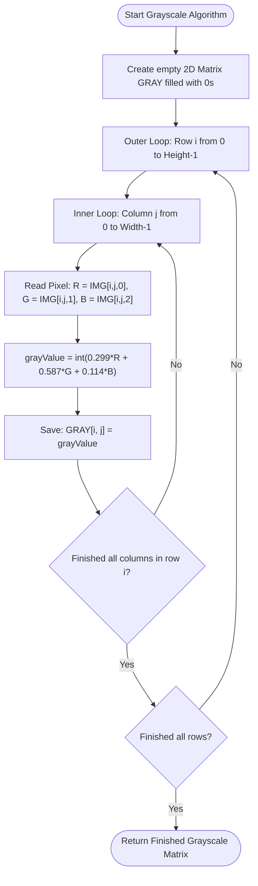
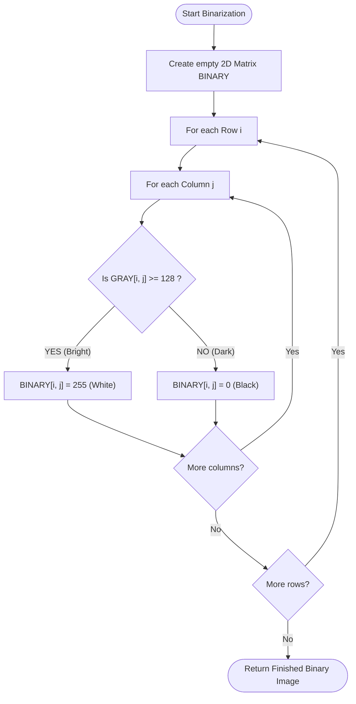

# 🎓 Digital Image Processing (DIP) — Section 2
## Visual Algorithm Guide & Pseudocode

> **For Teaching Assistants & Students:**  
> This guide breaks down the core concepts visually **before** you write Python code.  
> *Tip: In VS Code, press `Ctrl + K, V` to open the visual Markdown Preview.*

---

## 🗺️ The Big Picture: What Are We Doing?

In this section, we take a color image and transform it through 3 stages of data reduction:

```
┌─────────────────────────┐       Luminance Formula       ┌─────────────────────────┐       Threshold T=128       ┌─────────────────────────┐
│     1. RGB COLOR        │   ────────────────────────►   │      2. GRAYSCALE       │   ─────────────────────►    │        3. BINARY        │
│                         │   Y = 0.299R+0.587G+0.114B    │                         │    If pixel >= 128 -> 255   │                         │
│  3 Channels (R, G, B)   │                               │    1 Channel (Gray)     │    Else            -> 0     │    1 Channel (0 or 255) │
│  24 bits per pixel      │                               │    8 bits per pixel     │                             │    1 bit useful info    │
└─────────────────────────┘                               └─────────────────────────┘                             └─────────────────────────┘
```

---

## 📍 Concept 1: How Images Are Arranged in Memory

An image is **not** an abstract picture file—it is a **giant spreadsheet (matrix) of numbers**:

```
           Column j = 0       Column j = 1       Column j = 2       ... Column j = Width-1
        ┌──────────────────┬──────────────────┬──────────────────┬──────────────────────┐
Row i=0 │  Pixel (0, 0)    │   Pixel (0, 1)   │   Pixel (0, 2)   │   ...                │
        ├──────────────────┼──────────────────┼──────────────────┼──────────────────────┤
Row i=1 │  Pixel (1, 0)    │   Pixel (1, 1)   │   Pixel (1, 2)   │   ...                │
        ├──────────────────┼──────────────────┼──────────────────┼──────────────────────┤
Row i=2 │  Pixel (2, 0)    │   Pixel (2, 1)   │   Pixel (2, 2)   │   ...                │
        └──────────────────┴──────────────────┴──────────────────┴──────────────────────┘
```

* **Index `i` (Row):** Moves **vertically DOWN** from $0$ to $\text{Height} - 1$.
* **Index `j` (Column):** Moves **horizontally RIGHT** from $0$ to $\text{Width} - 1$.
* **For RGB:** Each box `(i, j)` contains **3 numbers**: `[Red, Green, Blue]`, each from $0$ to $255$.

---

## 1️⃣ Algorithm 1: Load Image & Inspect First 5 × 5 Pixels

### 💡 Visual Concept: Why inspect only 5 × 5?
A normal image has **178,000+ pixels**. If we printed all of them, the screen would freeze. We only peek at a tiny $5 \times 5$ window at the top-left corner:

```
Image (359 x 496)
┌────────────┬──────────────────────────────────┐
│ [5x5 Peek] │                                  │
│ 25 pixels  │                                  │
├────────────┘                                  │
│                                               │
│             Remaining 178,000+ pixels         │
│                                               │
└───────────────────────────────────────────────┘
```

### 📋 Pseudocode:
```text
ALGORITHM LoadAndInspect(filePath):
    1. Read raw image from disk and standardize to RGB
    2. Convert into a 3D Matrix: IMG with shape [Height, Width, 3]
    3. Print image dimensions: Height, Width, Channels
    
    4. // Safety check: choose 5 or image size if image is smaller than 5
       maxRows ← min(5, Height)
       maxCols ← min(5, Width)
       
    5. FOR i from 0 TO (maxRows - 1) DO:
           FOR j from 0 TO (maxCols - 1) DO:
               PRINT "Pixel [", i, ",", j, "] = ", IMG[i, j]
           END FOR
       END FOR
```

### 🔍 Why `min(5, Height)`?
* If the image has 359 rows $\to \min(5, 359) = \mathbf{5}$ rows printed.
* If a test image only has 3 rows $\to \min(5, 3) = \mathbf{3}$ rows printed (**prevents program crash!**).

---

## 2️⃣ Algorithm 2: RGB to Grayscale Conversion

### 💡 Visual Concept: The Color-to-Gray Engine
At each pixel `(i, j)`, we combine the 3 color channels into **one brightness number**:

```
Pixel [i, j] in RGB
  ┌─────────────┐
  │ Red   = 128 │ ─── x 0.299 ──►  38.27
  │ Green = 114 │ ─── x 0.587 ──►  66.92    ───► SUM = 124.23 ──► Round to INT: 124
  │ Blue  = 167 │ ─── x 0.114 ──►  19.04
  └─────────────┘
                                                    │
                                                    ▼
                                  Saved in: GRAY[i, j] = 124
```

### 🧠 Why these weights?
* **Green ($\approx 59\%$):** Human eyes have the most Green cone cells. Green appears brightest to us.
* **Red ($\approx 30\%$):** Medium brightness sensitivity.
* **Blue ($\approx 11\%$):** Human eyes are least sensitive to blue brightness.

### 📋 Pseudocode:
```text
ALGORITHM RGBToGrayscale(IMG):
    1. Height ← NumberOfRows(IMG)
    2. Width  ← NumberOfColumns(IMG)
    
    3. // Create a blank black 2D canvas of size [Height, Width]
       GRAY ← Create2DArray(Height, Width, type = UINT8, defaultValue = 0)
       
    4. FOR i from 0 TO (Height - 1) DO:
           FOR j from 0 TO (Width - 1) DO:
               // Step A: Extract channels (convert to int to prevent overflow)
               R ← int(IMG[i, j, 0])
               G ← int(IMG[i, j, 1])
               B ← int(IMG[i, j, 2])
               
               // Step B: Calculate perceived luminance
               grayValue ← int(0.299 * R + 0.587 * G + 0.114 * B)
               
               // Step C: Save into our 2D canvas
               GRAY[i, j] ← grayValue
           END FOR
       END FOR
       
    5. RETURN GRAY
```

### 🔄 Grayscale Flowchart:


---

## 3️⃣ Algorithm 3: Grayscale to Binary (Thresholding)

### 💡 Visual Concept: The Black & White Decision Line
Every pixel in the grayscale image is compared against a cutoff boundary (**Threshold $T = 128$**):

```
       0 (Pitch Black)                     128 (Threshold)                     255 (Pure White)
       ◄─────────────────────────────────────────┼────────────────────────────────────────►
                 LOWER THAN 128                  │              128 OR HIGHER
             Becomes: 0 (BLACK)                  │           Becomes: 255 (WHITE)
```

### 📋 Pseudocode:
```text
ALGORITHM GrayscaleToBinary(GRAY, threshold = 128):
    1. Height ← NumberOfRows(GRAY)
    2. Width  ← NumberOfColumns(GRAY)
    
    3. // Create empty 2D binary canvas
       BINARY ← Create2DArray(Height, Width, type = UINT8, defaultValue = 0)
       
    4. FOR i from 0 TO (Height - 1) DO:
           FOR j from 0 TO (Width - 1) DO:
               IF GRAY[i, j] >= threshold THEN:
                   BINARY[i, j] ← 255    // White (Foreground)
               ELSE:
                   BINARY[i, j] ← 0      // Black (Background)
               END IF
           END FOR
       END FOR
       
    5. RETURN BINARY
```

### 🔄 Binary Flowchart:


---

## 📊 Summary Comparison for Students

| Attribute | 1. RGB Color | 2. Grayscale | 3. Binary |
| :--- | :--- | :--- | :--- |
| **Number of Channels** | **3** (Red, Green, Blue) | **1** (Luminance) | **1** (Mask) |
| **Matrix Dimensions** | `(Height, Width, 3)` | `(Height, Width)` | `(Height, Width)` |
| **Possible Values** | $[0..255]$ for each of 3 colors | Any number between $0$ and $255$ | **Only two values:** $0$ or $255$ |
| **What $0$ means** | No light in that color channel | Pitch black | Background |
| **What $255$ means** | Maximum light in that color | Pure white | Foreground |
| **Main DIP Purpose** | Realistic photography | Structure, edges, lighting | Object isolation & segmentation |
