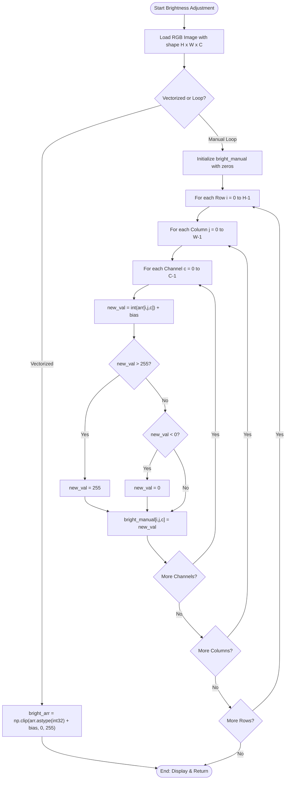
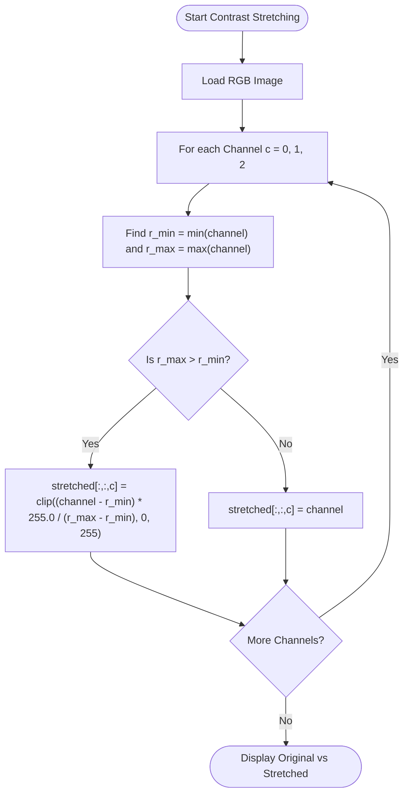
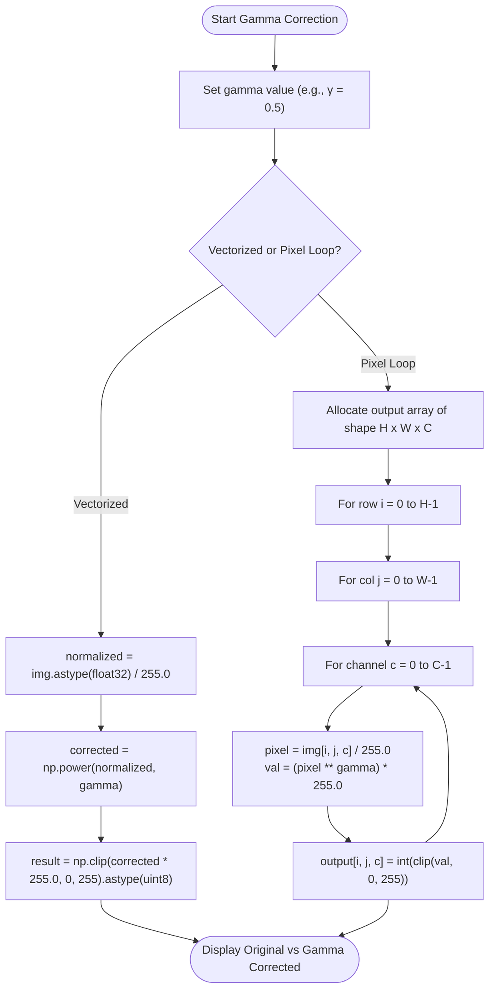
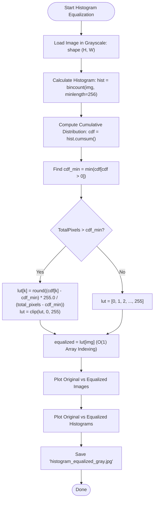

# 🎓 Digital Image Processing (DIP) — Section 3
## Visual Algorithm Guide & Pseudocode
### Spatial Domain Transformations: Brightness, Contrast Stretching, Gamma Correction & Histogram Equalization

> **For Teaching Assistants & Students:**  
> This guide visually breaks down point-processing transformations in the spatial domain **before** writing Python code.  
> *Tip: In VS Code, press `Ctrl + K, V` to open the visual Markdown Preview with interactive flowcharts and formulas.*

---

## 🗺️ The Big Picture: What Are We Doing?

In this section, we study **Spatial Domain Point Processing**.  
In point processing, each output pixel $s$ at coordinate $(x, y)$ depends **solely** on the input pixel $r$ at the exact same location:
$$s = T(r)$$
where $r$ is the input intensity, $s$ is the output intensity, and $T$ is the transformation transfer function.

```
┌──────────────────────────────────────────────────────────────────────────────────────────────────┐
│                            POINT PROCESSING TRANSFER FUNCTIONS s = T(r)                         │
└──────────────────────────────────────────────────────────────────────────────────────────────────┘

   1. Brightness Adjustment          2. Contrast Stretching            3. Gamma Correction (γ=0.5)
      s = r + bias                      s = (r - r_min)/(r_max-r_min)     s = (r / 255)^γ * 255
   s ▲                               s ▲                               s ▲
 255 ┤      /                      255 ┤        /                    255 ┤     .---'
     │     /                           │       /                         │   .'
     │    /                            │      /                          │  /
bias ┤   /                             │     /                           │ /
   0 ┼───┴──────►                    0 ┼────/──────►                   0 ┼─/────────►
     0         255   r                 0 r_min r_max 255   r             0         255   r
   (Histogram Shift)                 (Dynamic Range Expansion)         (Non-Linear Shadow Expansion)

                                   4. Histogram Equalization
                                      s = round( (CDF(r) - CDF_min) / (Total - CDF_min) * 255 )
                                   s ▲
                                 255 ┤            /▔▔▔
                                     │         .-'
                                     │      .-'
                                     │   .-'
                                   0 ┼──'──────────►
                                     0            255   r
                                   (Uniform Flat Histogram)
```

---

## 📍 Concept 1: Matrix Representation & Clamping

In 8-bit digital imaging, all intensity values are constrained to the discrete interval:
$$[0, 255] \quad \text{where } 0 = \text{Black, } 255 = \text{White}$$

### ⚠️ The Overflow / Underflow Problem:
* In 8-bit unsigned arithmetic (`uint8`), $250 + 50 = 44$ (modulo $256$ wrap-around!).
* A bright sky pixel would suddenly turn into a black spot.
* Therefore, all mathematical operations must be performed using higher precision (`int32` or `float32`) and then **clamped (clipped)**:

$$\text{clamp}(v, 0, 255) = \begin{cases} 0 & \text{if } v < 0 \\ 255 & \text{if } v > 255 \\ v & \text{otherwise} \end{cases}$$

---

## 1️⃣ Algorithm 1: Brightness Adjustment (Linear Offset)

### 💡 Visual Concept: Shifting the Intensity Distribution
Adding a positive scalar bias shifts all pixel intensities toward the white end of the spectrum (brightening). A negative bias shifts them toward dark (dimming).

```
Input Histogram (Original)                  Output Histogram (Shifted +50)
     |                                              |
     |   ▄█▄                                        |         ▄█▄
     |  █████                                       |        █████
   0 └──█████───────► 255                         0 └────────█████▄▄► 255 (Clipped)
```

### 📋 Mathematical Formulation:
$$s(i, j, c) = \text{clip}\Big(r(i, j, c) + \text{bias}, \; 0, \; 255\Big)$$

### 📋 Pseudocode:
```text
ALGORITHM BrightnessAdjustment(IMG, bias):
    1. Height ← NumberOfRows(IMG)
    2. Width  ← NumberOfColumns(IMG)
    3. Channels ← NumberOfChannels(IMG)
    
    // Method 1: Vectorized (NumPy Array Math)
    BRIGHT_VEC ← Clip(To_Int32(IMG) + bias, min = 0, max = 255) as UINT8
    
    // Method 2: Pixel-by-Pixel Manual Loop
    BRIGHT_MANUAL ← Create3DArray(Height, Width, Channels, type = UINT8)
    
    FOR i from 0 TO (Height - 1) DO:
        FOR j from 0 TO (Width - 1) DO:
            FOR c from 0 TO (Channels - 1) DO:
                new_val ← int(IMG[i, j, c]) + bias
                
                IF new_val > 255 THEN:
                    new_val ← 255
                ELSE IF new_val < 0 THEN:
                    new_val ← 0
                END IF
                
                BRIGHT_MANUAL[i, j, c] ← new_val
            END FOR
        END FOR
    END FOR
    
    RETURN BRIGHT_VEC, BRIGHT_MANUAL
```

### 🔄 Brightness Flowchart:


---

## 2️⃣ Algorithm 2: Contrast Stretching (Min-Max Normalization)

### 💡 Visual Concept: Expanding the Dynamic Range
When an image is captured under poor lighting or hazy conditions, its pixel intensities occupy only a narrow sub-range $[r_{\min}, r_{\max}]$ instead of the full $[0, 255]$.  
Contrast stretching linearly stretches this sub-range to cover the full spectrum $[0, 255]$:

```
Narrow Input Range:        [ r_min ========= r_max ]
                                 \             /
                                  \           /
                                   ▼         ▼
Stretched Output Range:    0 [=======================] 255
```

### 📋 Mathematical Formulation:
For each color channel $c \in \{0, 1, 2\}$:
$$s = \frac{r - r_{\min}}{r_{\max} - r_{\min}} \times 255.0$$
* If $r_{\max} > r_{\min}$: apply stretching and clamp to $[0, 255]$.
* If $r_{\max} = r_{\min}$: (flat constant channel) retain original values to avoid division by zero.

### 📋 Pseudocode:
```text
ALGORITHM ContrastStretching(IMG):
    1. STRETCHED ← CreateLike(IMG)
    
    2. FOR each channel c in {0, 1, 2} DO:
           channel ← ConvertToFloat32(IMG[:, :, c])
           r_min   ← MinimumValue(channel)
           r_max   ← MaximumValue(channel)
           
           IF r_max > r_min THEN:
               scaled ← (channel - r_min) * (255.0 / (r_max - r_min))
               STRETCHED[:, :, c] ← Clip(scaled, 0, 255) as UINT8
           ELSE:
               STRETCHED[:, :, c] ← channel as UINT8
           END IF
       END FOR
       
    3. RETURN STRETCHED
```

### 🔄 Contrast Stretching Flowchart:


---

## 3️⃣ Algorithm 3: Gamma Correction (Power-Law Transformation)

### 💡 Visual Concept: Non-Linear Tone Mapping
Human perception of brightness is non-linear (Weber-Fechner Law / Stevens' Power Law).  
Linear operations (like adding a constant) brighten all pixels equally, washing out bright areas. Gamma correction uses an exponential power curve:
$$s = c \cdot r^\gamma$$

```
Output s
 255 ▲
     │            .-'  γ < 1 (e.g. γ = 0.5): Expands Dark Shadows, Brightens Image
     │         .-'
     │       .'
     │     .'     /    γ = 1.0: Linear Identity (No change)
     │   .'     /
     │  /     /
     │ /    .'         γ > 1 (e.g. γ = 2.2): Compresses Highlights, Darkens Image
     │/  .-'
   0 ┼──'─────────────► 255
     0                Input r
```

### ⚙️ Why normalize to $[0, 1]$ first?
If we directly compute $200^{0.5} \approx 14.14$, the image would appear pitch black!  
We must:
1. Normalize to unit float: $r_{\text{norm}} = \frac{r}{255.0} \in [0.0, 1.0]$
2. Apply exponent: $s_{\text{norm}} = r_{\text{norm}}^\gamma \in [0.0, 1.0]$
3. Denormalize: $s = \text{clip}(s_{\text{norm}} \times 255.0, \; 0, \; 255)$

### 📋 Pseudocode:
```text
ALGORITHM GammaCorrection(IMG, gamma):
    // Method A: Vectorized (NumPy)
    norm ← ConvertToFloat32(IMG) / 255.0
    corrected ← (norm ^ gamma) * 255.0
    RESULT_VEC ← Clip(corrected, 0, 255) as UINT8
    
    // Method B: Pixel-by-Pixel Loop
    Height, Width, Channels ← Shape(IMG)
    RESULT_MANUAL ← Create3DArray(Height, Width, Channels, type = UINT8)
    
    FOR i from 0 TO (Height - 1) DO:
        FOR j from 0 TO (Width - 1) DO:
            FOR c from 0 TO (Channels - 1) DO:
                pixel_norm ← IMG[i, j, c] / 255.0
                val ← (pixel_norm ^ gamma) * 255.0
                RESULT_MANUAL[i, j, c] ← int(Clip(val, 0, 255))
            END FOR
        END FOR
    END FOR
    
    RETURN RESULT_VEC, RESULT_MANUAL
```

### 🔄 Gamma Correction Flowchart:


---

## 4️⃣ Algorithm 4: Histogram Equalization (Grayscale CDF & LUT Mapping)

### 💡 Visual Concept: Flat, Uniform Distribution of Intensities
An image histogram shows the frequency of every intensity $k \in [0, 255]$.  
Histogram Equalization flattens the cumulative distribution function (CDF) to a linear slope, spreading clustered intensities across all 256 levels:

```
Original Image (Low Contrast / Clustered)     Equalized Image (High Contrast / Uniform)
Histogram h(r):                               Histogram h(s):
  ▲                                             ▲
  │     █████                                   │  █   █   █   █   █   █   █
  │    ███████                                  │  █   █   █   █   █   █   █
  └───█████████────►                              └──█───█───█───█───█───█───█──►
  0   100   150    255                          0                             255
```

### 📐 Mathematical Derivation & Formulation:

1. **Histogram Calculation:**
   $$h(k) = \sum_{i=0}^{H-1} \sum_{j=0}^{W-1} \mathbf{1}_{\{f(i, j) = k\}}, \quad k = 0, 1, \dots, 255$$

2. **Cumulative Distribution Function (CDF):**
   $$CDF(k) = \sum_{j=0}^{k} h(j)$$
   $CDF(255) = \text{Total Pixels} = H \times W$.

3. **Lookup Table (LUT) Mapping Formula:**
   To ensure the lowest present intensity maps exactly to $0$, we subtract $CDF_{\min}$ (the first non-zero CDF value):
   $$LUT(k) = \text{round}\left( \frac{CDF(k) - CDF_{\min}}{\text{Total Pixels} - CDF_{\min}} \times 255.0 \right)$$
   and clamp to $[0, 255]$.

4. **Fast $O(1)$ Application:**
   $$\text{Equalized}(i, j) = LUT\big(f(i, j)\big)$$

### 📋 Worked Miniature Example (Step-by-Step):
Imagine a tiny $4 \times 4$ image ($16$ total pixels) with 4 gray levels $[0, 1, 2, 3]$:
* Intensities count: $h = [0, 8, 6, 2]$
* CDF: $CDF = [0, 8, 14, 16]$
* $CDF_{\min} = 8$ (first non-zero value at level 1).
* Total pixels $= 16$.
* Denominator $= 16 - 8 = 8$. Max output $= 3$.

| Gray Level $k$ | Histogram $h(k)$ | $CDF(k)$ | Formula: $\frac{CDF(k) - 8}{16 - 8} \times 3$ | Rounded $LUT(k)$ |
| :---: | :---: | :---: | :---: | :---: |
| **0** | 0 | 0 | (Below $CDF_{\min} \to 0$) | **0** |
| **1** | 8 | 8 | $\frac{8 - 8}{8} \times 3 = 0.0$ | **0** |
| **2** | 6 | 14 | $\frac{14 - 8}{8} \times 3 = 2.25$ | **2** |
| **3** | 2 | 16 | $\frac{16 - 8}{8} \times 3 = 3.0$ | **3** |

*Notice:* Level 1 (originally 8 pixels) was mapped to 0, level 2 was mapped to 2, and level 3 to 3. The dynamic range expanded!

### 📋 Pseudocode:
```text
ALGORITHM HistogramEqualization(GRAY_IMG):
    1. TotalPixels ← Width * Height
    
    2. // Step 1: Compute frequency of each intensity (0 to 255)
       hist ← CountBinFrequencies(GRAY_IMG, bins = 256)
       
    3. // Step 2: Compute Cumulative Distribution Function (running sum)
       cdf ← CumulativeSum(hist)
       
    4. // Step 3: Find first non-zero CDF value
       cdf_min ← MinValueOf(cdf WHERE cdf > 0)
       
    5. // Step 4: Construct Lookup Table (LUT)
       LUT ← CreateArray(length = 256, type = UINT8)
       
       IF TotalPixels > cdf_min THEN:
           FOR k from 0 TO 255 DO:
               val ← round((cdf[k] - cdf_min) * 255.0 / (TotalPixels - cdf_min))
               LUT[k] ← Clip(val, 0, 255)
           END FOR
       ELSE:
           LUT ← IdentityArray(0 to 255)
       END IF
       
    6. // Step 5: Fast Mapping
       EQUALIZED ← LUT[GRAY_IMG]
       
    7. RETURN EQUALIZED, hist, LUT
```

### 🔄 Histogram Equalization Flowchart:


---

## 📊 Summary Comparison for Students

| Transformation | Mathematical Mapping | Dynamic Range Effect | Input Domain | Key Characteristic |
| :--- | :--- | :--- | :--- | :--- |
| **1. Brightness Bias** | $s = \text{clip}(r + b, 0, 255)$ | Rigid translation (histogram shifts left/right) | RGB / Gray | Simple linear offset; prone to clipping highlight/shadow details |
| **2. Contrast Stretch** | $s = \frac{r - r_{\min}}{r_{\max} - r_{\min}} \times 255$ | Linear expansion of $[r_{\min}, r_{\max}]$ to $[0, 255]$ | Per-channel RGB | Recovers washed-out details; sensitive to outlier noise pixels |
| **3. Gamma Correction** | $s = 255 \times \left(\frac{r}{255}\right)^\gamma$ | Non-linear power curve; adjusts shadows/midtones | RGB / Gray | Matches human vision; $\gamma < 1$ brightens, $\gamma > 1$ darkens |
| **4. Histogram Equalization** | $s = T_{\text{CDF}}(r)$ via LUT | Non-linear dynamic re-allocation based on cumulative frequency | Grayscale (L) | Fully automated global contrast maximization; yields flat histogram |
